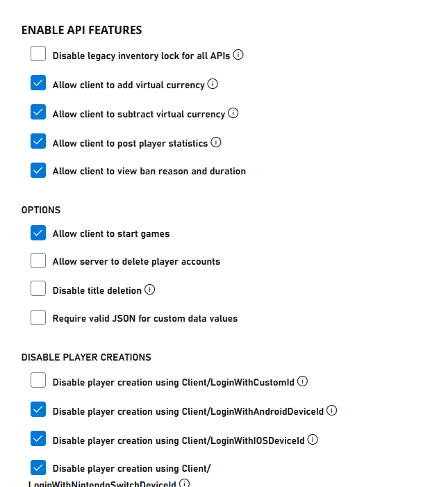
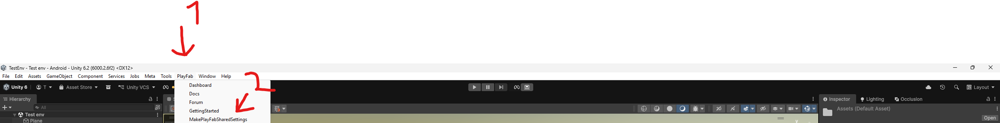

# PlayFab-Login-System
A login system for VR games made for Oculus Quest.

# Dependencies

- [The PlayFab Unity SDK](https://github.com/PlayFab/UnitySDK) [(Download)](https://aka.ms/PlayFabUnitySdk)
- [Photon VR (I used my forked version of it but I don't think it will be necessary to use it)](https://github.com/fchb1239/PhotonVR) [Forked version](https://github.com/TMTimeVR/PhotonVR)
- [The Meta XR All-in-One SDK](https://assetstore.unity.com/packages/tools/integration/meta-xr-all-in-one-sdk-269657)
- TextMeshPro
- [Glitched Cat Studios's Wardrobe System](https://github.com/Glitched-Cat-Studios/GCS-Wardrobe)

# DISCLAIMER:

**Yes, AI (Claude) was used in this system. Claude was used as a second pair of eyes, not just something that generates code that I instantly put into this system.**
This is (probably) a safe and secure backend. I dunno, don't take my word on it. This is an older version of the backend in [Monkey Mall](https://www.meta.com/en-gb/experiences/chimpstitute/6878051502218331/).

This isn't enterprise-ready. Use this for your hobby project, or to just inspire yourself.

# Credits:

I used large code snippets of SolarisDev09's [AdvancedPlayFab](https://github.com/SolarisDev09/AdvancedPlayfab?tab=readme-ov-file) and JokerJosh0's [EasyPlayFab](https://github.com/JokerJosh0/EasyPlayfab).
I also used [some random PlayFab login script from 2023](https://github.com/TMTimeVR/PlayFab-Login-System/blob/main/SomeRandomPlayFabLoginScriptFrom2023.cs). I think it was made by someone called "MONKI".

The APK hash verification snippet (`IsGameRunning` in `main/LoginPF.cs`) was made by [MaxNiftyNine](https://github.com/MaxNiftyNine), following [this guide](https://github.com/TMTimeVR/PlayFab-Login-System/raw/refs/heads/main/guide/How%20to%20add%20anticheat%20to%20your%20gorilla%20tag%20fan%20game%20(stop%20moddinghacking).mp4).

That doesn't make this a pile of other people's snippets. A big part of the code is mine.

# Setup:

1. **Import the dependencies.** Import the PlayFab Unity SDK, Photon PUN, Photon Voice, PhotonVR, the GCS Wardrobe System and the Meta XR All-in-One SDK. If you are prompted to import TextMeshPro, do so.

2. **Add the scripts.** Place [`main/LoginPF.cs`](main/LoginPF.cs) in your project (e.g. `Assets/Scripts/`). The `creditsURL`, `motdURL`, `uURL`, `ltURL` and `woURL` fields near the top point at placeholder URLs (`YOUR_USERNAME/YOUR_REPO`). Change them to your own remote text files, or delete the features that use them if you don't want a MOTD, credits or version gate.

3. **Enable the PlayFab API features.** In the PlayFab Game Manager, open **Settings → API Features**:

   

   Enable the options shown here:

   

4. **Set your Title ID.** In Unity, click **PlayFab → MakePlayFabSharedSettings** at the top of the window and enter your Title ID:

   

5. **Upload the Cloud Script.** `LoginPF.cs` relies on server-side handlers (`VOI`, `GetPhotonAuth`, `AnnounceLogin`, `banPlayer`, `permBanPlayer`, and more). In the Game Manager, go to **Automation → Cloud Script**, paste the contents of [`main/cloudscripts.js`](main/cloudscripts.js) into a new revision, save it, and **deploy it as the live revision**.

6. **Configure your secrets in Internal Title Data.** The Cloud Script reads every secret and endpoint from server-only Internal Title Data. Never put these in client-readable Title Data, and never hard-code them in the scripts. In the Game Manager, open **Content → Title Data → Internal Title Data** and add the keys you need:

   | Key | Purpose |
   |-----|---------|
   | `PUN` | Photon Realtime AppId (base64-encoded) |
   | `VOICE` | Photon Voice AppId (base64-encoded) |
   | `APP_ID` | Meta/Oculus application ID |
   | `APP_SECRET` | Meta/Oculus application secret |
   | `MODERATOR_IDS` | JSON array of moderator PlayFab IDs, e.g. `["ABC123","DEF456"]` |
   | `ALLOW_UNVERIFIED_PHOTON` | Development only. An expiry timestamp, not a boolean. See the note below. |
   | `MIN_CLIENT_VERSION` | Optional. Clients older than this are refused the Photon AppIds, e.g. `3.6.0`. Leave unset to allow any version. |
   | `WEBHOOK_BANS`, `WEBHOOK_VOICE`, `WEBHOOK_WARNINGS`, `WEBHOOK_REPORTS`, `WEBHOOK_LOGIN`, `WEBHOOK_LOBBY` | Notification endpoints. Optional, and handlers still work if a key is unset. |
   | `META_HASH`, `IL2CPP_HASH` | Expected build hashes for the optional binary-integrity check. Optional. |
   | `RATE_*` | Written by the Cloud Script itself for the title-wide rate limiter. Do not set these by hand. |

   **How identity verification works.** `VOI` checks the player's Oculus nonce with Meta. Only if Meta says yes does it write the Oculus ID into User Internal Data, which the server can write and the client cannot. Anything that matters then checks for that verification before it acts: `GetPhotonAuth` will not hand out the Photon AppIds, and `banPlayer`, `permBanPlayer`, `ACB`, `RequestAccountDeletion` and `SendVoiceToDiscord` all refuse an unverified session.

   That gate is the whole point. `LoginPF.cs` also calls `FC()` when `VOI` fails, but a modded client deletes that line, so the client-side half enforces nothing. What the server withholds is the only part that survives a hooked client.

   Why the destructive handlers are gated too: login is `LoginWithCustomID` with the Oculus ID as the credential, so anyone who learns another player's ID can get a session as them. Before the gate, that session could ban and delete the victim without ever passing `VOI`. Now it can do nothing of the kind.

   `GetPhotonAuth` also refuses a banned account and a client older than `MIN_CLIENT_VERSION`. Both of those used to be enforced by toggling objects on the client, which a modded client ignores. Withholding the AppIds is the same pattern as the identity gate, and it works for the same reason. Two honest limits: it takes effect on the next connect, so a player banned mid-session keeps playing until they reconnect, and the version number comes from the client so a modded build can lie about it. Removing a banned player from a live room needs a Photon webhook; the version gate is for honest clients that are out of date.

   Do not store the Oculus ID from the client. Any client can overwrite its own User Data through `UpdateUserData`, so what the client puts there is a claim, not a fact.

   `ALLOW_UNVERIFIED_PHOTON` exists because the Unity Editor has no real Oculus nonce to check, so `LoginPF.cs` skips `VOI` under `#if UNITY_EDITOR`. **Its value is an expiry timestamp**, for example `2026-10-01T00:00:00Z`. While that time is in the future, unverified sessions get the Photon AppIds and every use is logged as a warning. Once it passes, the flag is ignored. `"true"` does nothing any more. That is deliberate: a boolean was too easy to leave on in production, and while it was on the gate was off for everyone.

   **Account deletion needs a scheduled task.** `RequestAccountDeletion` marks the account and starts a 48 hour window. The actual `DeleteUser` in `PerformDeletionChecks` refuses to run from a client call. Create a scheduled task in the Game Manager under **Automation → Scheduled Tasks** that runs `PerformDeletionChecks` daily against a segment of players whose read-only data has `pendingDeletion` equal to `true`. Without that task nothing is ever deleted, which is the safe failure but not the intended one.

7. **Set up the GCS Wardrobe.** Follow the [GCS Wardrobe setup guide](guide/GCSWARDROBETUTORIAL.mp4) (made by The Tech Wizard).

   One thing to know: GCS-Wardrobe checks cosmetic ownership only in the local UI. Equipping calls `PhotonVRManager.SetCosmetic(...)`, which writes a string into the player's Photon custom properties, and other clients activate whatever name arrives. So a modded client can wear a cosmetic it never bought. Nothing is actually granted, so it is spoofing rather than theft, but if rare cosmetics are your reward loop it defeats the point. Check the equipped ID against the server-side inventory before broadcasting it.

8. **(Optional) Enable the APK signature check.** `LoginPF.cs` has an `EXPECTED_SIGNATURE_HASH` constant. Left at `0` the check is off and the game runs normally. To turn it on, set it to your release keystore signature's `hashCode` (see [MaxNiftyNine's guide](guide/How%20to%20add%20anticheat%20to%20your%20gorilla%20tag%20fan%20game%20%28stop%20moddinghacking%29.mp4)). It runs on the client, so it is a speed bump. Anyone can patch it out of a decompiled APK. Never make it your only protection.

> **Security note.** This is client code and cannot be trusted. Keep every secret in Internal Title Data, and put anything that matters inside Cloud Script: identity checks, currency and purchase grants, bans. Never on the client.

# Security

A full review of this project and its dependencies is in [reports/security-review.md](reports/security-review.md). It covers what was found, what was fixed, and what is still open. Found something it missed? [SECURITY.md](SECURITY.md) has contact details.

## What is still open

Read this before you ship. These are known, not fixed, and a modded client can reach every one of them.

**Account takeover from a leaked Oculus ID.** Login is `LoginWithCustomID` with the org-scoped Oculus ID as the only credential. Anyone who learns another player's ID gets a session as that player. The verification gate stops that session from doing anything destructive or reaching multiplayer, but it cannot stop the session existing. The fix is to mint the PlayFab session from Meta's proof rather than checking it afterward, which is an architecture change and has not been made.

**One headset, unlimited accounts.** The identity binding stops a second Oculus user claiming an account, but nothing stops one Oculus user creating many accounts. A banned player makes a fresh account, verifies it with the same real headset, and is back in. Bans are therefore friction, not enforcement, until the binding is made bidirectional.

**Anti-cheat on the client is telemetry.** `HasMods`, `VerifyBinaryIntegrity` and the APK signature check all run on the client. Mod menus for this family of games use native injection after login, so they load no managed assembly for `HasMods` to see, submit the known-good hashes to the integrity check, and patch out the signature check. Treat these as signals, never as controls. The signature check ships disabled.

**Mid-session bans are enforced by the banned client.** A player banned while in a room is only removed because their own client polls for the ban and disconnects itself. A modded client skips that. Removing a banned player from a live room needs a Photon server-side webhook.

**Voice mute is advisory.** `setVoiceMute` writes to data the muted client reads and chooses to honour. The only players worth muting are the ones who will not.

**Player tracking through Photon.** The Photon UserId is the PlayFab ID, which is stable across sessions. Photon's `FindFriends` returns the exact room any UserId is in, including private rooms, and cannot be disabled on Photon Cloud. Meeting a player once is enough to follow them anywhere until the Photon UserId is decoupled from the account.

**Rate limits are per title, not per player.** After the September 2026 changes every webhook path has a title-wide ceiling as well as a per-account one, because accounts are free to make. The ceiling is thirty posts per minute per webhook. A determined flood is still a flood; it is just a bounded one.

# Should I use this for my hobby project?
As a starting point, sure. I would not drop it into a game and assume authentication is solved. Read the review first.
